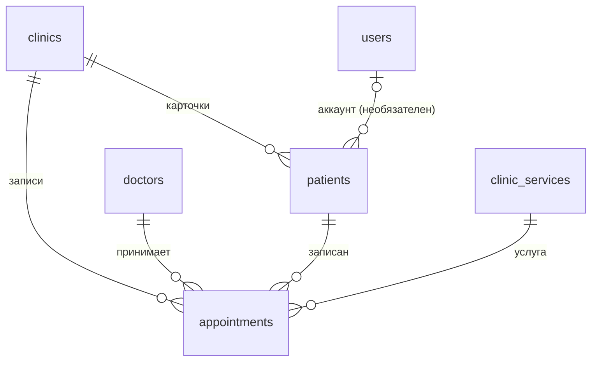
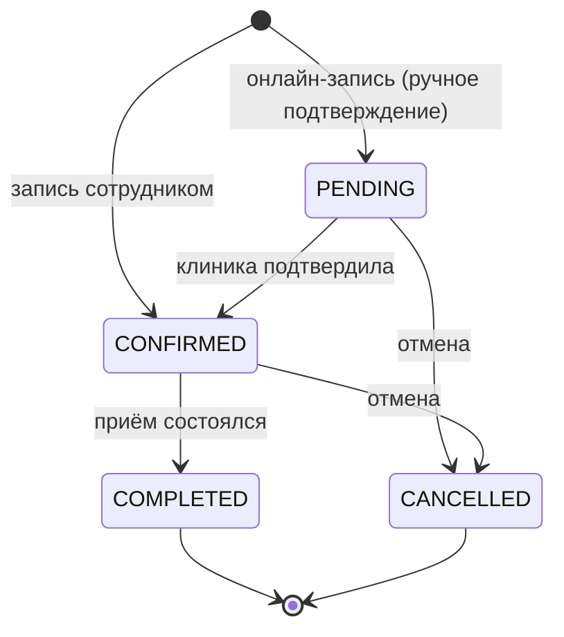

# Контекст `appointment`

Код: `src/modules/appointment/`. Сейчас реализован только слой persistence (сущности и перечисления);
доменный слой, команды и запросы — следующий этап.

## Термины

- **Пациент** (`patients`) — карточка пациента **в конкретной клинике**. У одного человека — своя карточка
  в каждой клинике, где он лечится ([ADR 0007](../adr/0007-patients-per-clinic.md)).
- **Аккаунт пациента** — строка `users`, связанная с карточками через `patients.user_id`. Может отсутствовать,
  если карточку завёл сотрудник. Создаётся воронкой по телефону (способ входа `PHONE`, без email и пароля) или
  обычной регистрацией ([ADR 0011](../adr/0011-phone-signup-funnel.md)).
- **Подтверждённый телефон** — `users.phone_verified_at is not null`: телефон аккаунта подтверждён кодом из SMS.
- **Запись** (`appointments`) — приём пациента у врача по услуге в интервал времени.

## Связи

## Жизненный цикл записи (`AppointmentStatus`)

- «Идёт приём» — не статус: подтверждённая запись, в интервал которой попадает текущее время.
- При отмене заполняются `cancelled_at` и `cancelled_by` (`PATIENT` / `CLINIC`).
- Режим «подтверждать автоматически» (настройка клиники) будет создавать онлайн-записи сразу в `CONFIRMED`.

## Источники записи (`AppointmentSource`)

| Значение  | Кто создаёт                      | Нужен подтверждённый телефон |
|-----------|----------------------------------|------------------------------|
| `WIDGET`  | пациент, виджет на сайте клиники | да                           |
| `WEBSITE` | пациент, страница записи         | да                           |
| `PHONE`   | сотрудник, пациент позвонил      | нет                          |
| `ADMIN`   | сотрудник в кабинете             | нет                          |

## Правила

| Правило                                                                                                | Где обеспечивается                                                                    |
|--------------------------------------------------------------------------------------------------------|---------------------------------------------------------------------------------------|
| Записи одного врача не пересекаются; отменённые слот не занимают                                       | БД: exclusion `appointments_doctor_id_no_overlap`                                     |
| Конец записи позже начала                                                                              | БД: `appointments_time_range_check`                                                   |
| `cancelled_at` и `cancelled_by` заданы тогда и только тогда, когда статус `CANCELLED`                  | БД: `appointments_cancellation_check`                                                 |
| Онлайн-запись (`WIDGET`, `WEBSITE`) — только с подтверждённым телефоном                                | домен (будет)                                                                         |
| Врач, пациент и услуга записи — из той же клиники, что и запись                                        | домен (будет); БД не проверяет                                                        |
| Запись — в рабочие часы врача (см. [clinic.md](clinic.md#как-определяются-рабочие-часы-врача-на-дату)) | домен (будет)                                                                         |
| Пациент отменяет не позднее чем за N часов (настройка клиники)                                         | домен (будет)                                                                         |
| Конкурентные изменения записи не перезаписывают друг друга                                             | ORM: `version` (оптимистичная блокировка)                                             |
| Одна карточка на телефон в клинике; одна карточка на аккаунт в клинике                                 | БД: `patients_clinic_id_phone_unique`, `patients_clinic_id_user_id_unique`            |
| Телефон в формате E.164                                                                                | приложение: value object `Phone` (будет) — иначе уникальность по телефону не работает |
| Подтверждения телефона без телефона не бывает                                                          | БД: `users_phone_verified_check`                                                      |
| У аккаунта есть email или телефон                                                                      | БД: `users_contact_check`                                                             |
| У аккаунта `PHONE` телефон всегда подтверждён                                                          | БД: `users_phone_method_check`                                                        |
| Ввод кода из SMS подтверждает владение номером: номер уходит из неподтверждённого чужого аккаунта      | домен (будет)                                                                         |
| Карточка, заведённая сотрудником по телефону, привязывается к аккаунту, а не дублируется               | домен (будет); БД: `patients_clinic_id_phone_unique`                                  |

## Время

- `starts_at`, `ends_at` — `timestamptz` (UTC). Границы суток, рабочие часы и сроки правил считаются
  в `clinics.timezone` ([ADR 0008](../adr/0008-appointment-time-model.md)).
- Конец записи по умолчанию — начало + `clinic_services.duration_minutes`, но хранится явно и может отличаться.

## Что вычисляется, а не хранится

- «Идёт приём», «Первый визит», «N визитов» (по завершённым записям карточки).
- Счётчики в расписании: «4 врача · 21 запись», «6 записей» у врача, «3 ждут подтверждения».
