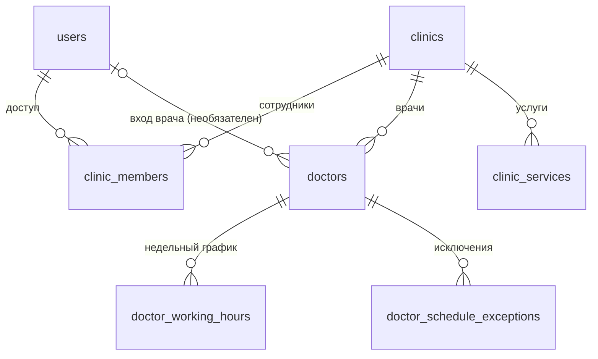
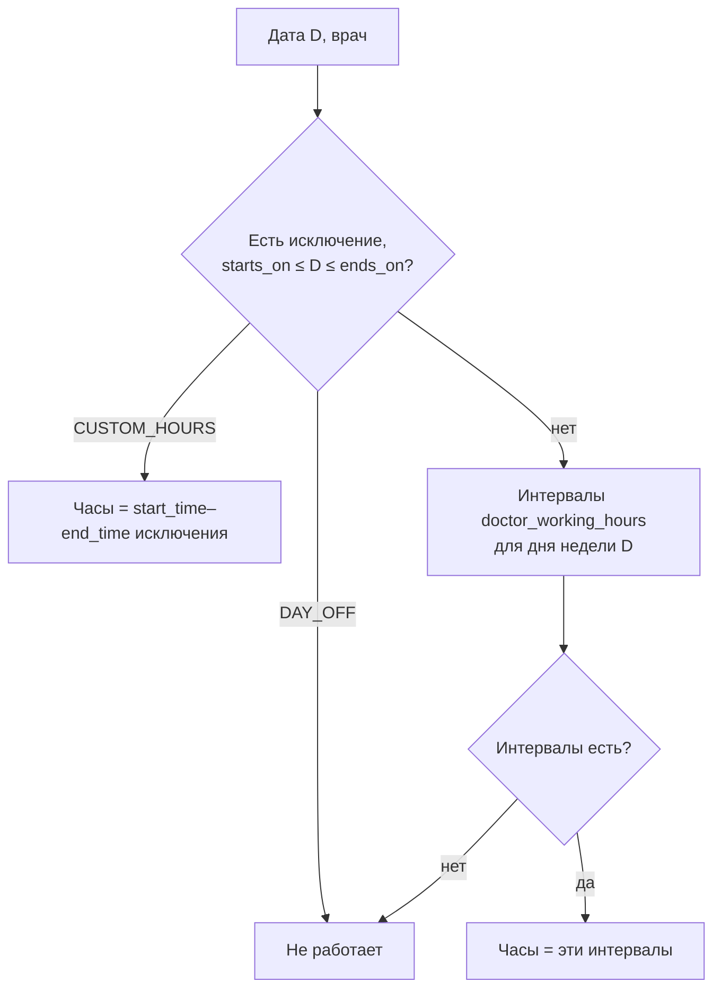

# Контекст `clinic`

Код: `src/modules/clinic/`. Сейчас реализован только слой persistence (сущности и перечисления);
доменный слой, команды и запросы — следующий этап.

## Термины

- **Клиника** (`clinics`) — филиал, пользующийся сервисом: своё расписание, сотрудники, врачи, услуги,
  часовой пояс. «ДентаЛюкс · Центральная» и «ДентаЛюкс · Лесная» — две клиники.
- **Сотрудник** (`clinic_members`) — учётная запись с доступом к кабинету клиники и ролью в ней.
- **Врач** (`doctors`) — тот, кто принимает пациентов; колонка в расписании. Может не иметь учётной записи.
- **Услуга** (`clinic_services`) — то, на что можно записаться; задаёт длительность записи по умолчанию.
- **Рабочие часы** (`doctor_working_hours`) — недельный график врача: интервалы по дням недели.
- **Исключение графика** (`doctor_schedule_exceptions`) — даты, когда недельный график не действует.

## Связи

## Роли в клинике (`ClinicMemberRole`)

| Значение | Что может                        |
|----------|----------------------------------|
| `OWNER`  | управлять тарифом и сотрудниками |
| `ADMIN`  | вести расписание и записи        |
| `DOCTOR` | видеть свои записи               |

Это роль **в конкретной клинике**; роль на платформе — `users.role` (см. [ADR 0006](../adr/0006-platform-and-clinic-roles.md)).

## Правила

| Правило                                                                                    | Где обеспечивается                                                    |
|--------------------------------------------------------------------------------------------|-----------------------------------------------------------------------|
| Пользователь видит данные клиники, только если у него есть строка `clinic_members` для неё | домен / guard (будет)                                                 |
| Один пользователь — одна роль в одной клинике                                              | БД: `clinic_members_clinic_id_user_id_unique`                         |
| Врач и услуга с записями не удаляются, а архивируются (`archived_at`)                      | БД: FK записей `no action`                                            |
| Длительность услуги больше нуля                                                            | БД: `clinic_services_duration_minutes_check`                          |
| Рабочий интервал: день недели 1–7 (ISO, 1 — понедельник), конец позже начала               | БД: `doctor_working_hours_*_check`                                    |
| Интервалы одного дня врача не дублируются по началу                                        | БД: `doctor_working_hours_doctor_id_weekday_start_time_unique`        |
| Интервалы одного дня врача не пересекаются                                                 | домен (будет)                                                         |
| Исключение: `ends_on >= starts_on`; часы заданы ровно для `CUSTOM_HOURS`                   | БД: `doctor_schedule_exceptions_*_check`                              |
| Непустые названия и имена                                                                  | приложение: DTO ([ADR 0005](../adr/0005-db-checks-for-logic-only.md)) |

## Как определяются рабочие часы врача на дату

- Перерыв — это два интервала одного дня (09:00–13:00 и 14:00–18:00), а не отдельная колонка.
- Время в графике — местное время клиники (`clinics.timezone`).
- `note` у исключения — подпись для людей («отпуск»), на расчёт не влияет.
- Добавление исключения не отменяет существующие записи: домен должен показать конфликтующие записи
  администратору для переноса или отмены (раздел «Врачи и график»).

## Где используются рабочие часы

- Свободные слоты для пациента: рабочие часы минус занятые записи, нарезка по длительности услуги.
- «Новая запись» у администратора: запись вне рабочих часов не создаётся или требует подтверждения.
- Сетка расписания: затенение нерабочего времени.

## Что появится в следующих разделах

- `clinics.slug` — с публичной страницей записи ([ADR 0009](../adr/0009-clinic-slug-deferred.md)).
- Профиль клиники (адрес, телефон, специализация) и правила онлайн-записи — с разделом «Настройки».
- Цена, категория, связь «врач ↔ услуги», флаг онлайн-записи у услуги — с разделом «Услуги и цены».
