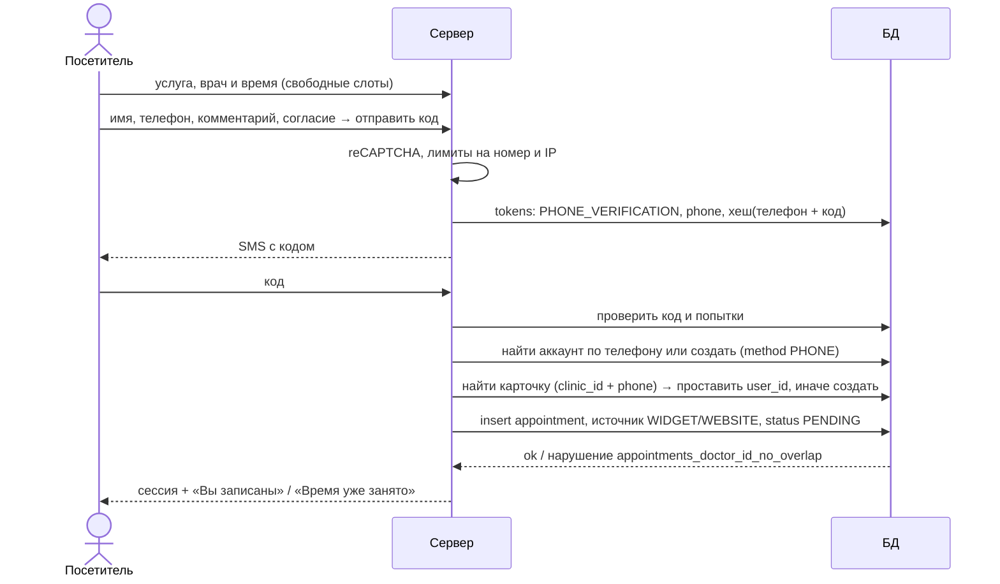
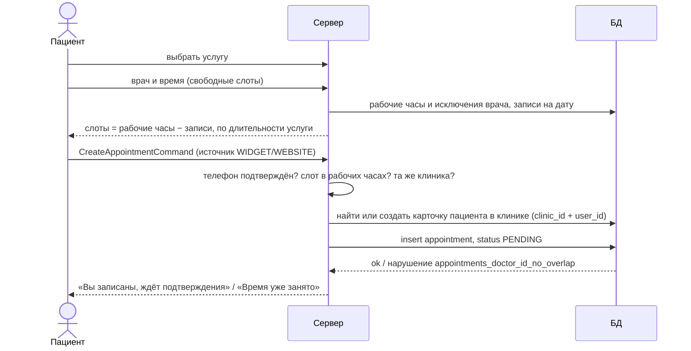

# Запись на приём

Статус: **спроектировано, не реализовано.** Схема БД готова, команды и запросы ещё не написаны —
названия команд ниже предварительные; при реализации обновить этот файл.

Правила, на которые опирается процесс, — в [domain/appointment.md](../domain/appointment.md) и
[domain/clinic.md](../domain/clinic.md).

## Воронка по телефону (без входа)

Вход из соцсетей и рекламных предложений, мобильный макет «Запись пациента»
([ADR 0011](../adr/0011-phone-signup-funnel.md)). **Участники:** посетитель без входа, клиника.

**Ошибки:**

| Ситуация                                        | Ответ                                                      |
|-------------------------------------------------|------------------------------------------------------------|
| Лимит отправки кодов на номер или IP исчерпан   | отказ, «повторить через N минут»                           |
| Неверный код                                    | осталось N попыток; после лимита — запросить новый код     |
| Код истёк                                       | запросить новый код                                        |
| Время заняли, пока вводили код                  | «время уже занято», вернуться к выбору времени             |

**Чей номер:** подтверждён в аккаунте — вход в этот аккаунт; указан без подтверждения в другом аккаунте —
номер переходит к вводящему код, у прежнего аккаунта очищается; не встречается — новый аккаунт `PHONE`.

## Онлайн-запись пациентом

**Участники:** пациент с аккаунтом, клиника. **Предусловие:** пациент вошёл, телефон подтверждён.

**Ошибки:**

| Ситуация                                      | Ответ                                                              |
|-----------------------------------------------|--------------------------------------------------------------------|
| Телефон не подтверждён                        | отказ: сначала подтвердить телефон                                 |
| Время вне рабочих часов или в исключении      | отказ                                                              |
| Слот занят (в том числе параллельной записью) | БД отклоняет вставку → «время уже занято», предложить другие слоты |

## Запись сотрудником клиники

**Участники:** сотрудник с ролью `ADMIN` или `OWNER`. **Предусловие:** есть строка `clinic_members`.

1. «Новая запись»: врач, услуга, время, пациент — существующая карточка или новая (имя + телефон,
   аккаунт не нужен).
2. `CreateAppointmentCommand` с источником `PHONE` или `ADMIN`; подтверждённый телефон не требуется.
3. Проверки: та же клиника, рабочие часы врача, пересечение (БД).
4. Статус сразу `CONFIRMED`.

## Подтверждение и отмена

- **Подтвердить** (`PENDING → CONFIRMED`) — сотрудник клиники.
- **Отменить** — сотрудник (`cancelled_by = CLINIC`) или пациент (`PATIENT`, не позднее срока из настроек
  клиники). Слот освобождается сразу: отменённые записи не участвуют в ограничении пересечений.
- Одновременные «Подтвердить» и «Отменить» — вторая операция получит конфликт версии (`version`).
