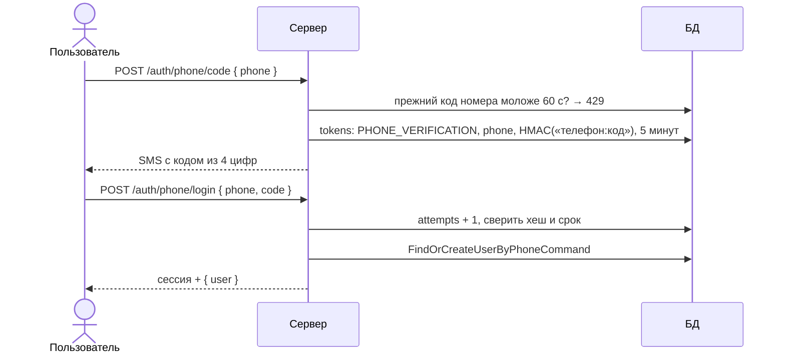

# Вход по телефону

Статус: **реализовано** (сервер и страница `/auth/login`, вкладка «Телефон»). Решения — [ADR 0011](../adr/0011-phone-signup-funnel.md),
[ADR 0012](../adr/0012-user-name-optional.md).

## Шаги

| Шаг | Команда | Модуль |
|---|---|---|
| Отправка кода | `SendPhoneCodeCommand` → `SendPhoneCodeHandler` | `auth` |
| Проверка кода и сессия | `LoginByPhoneCommand` → `LoginByPhoneHandler` | `auth` |
| Аккаунт по номеру | `FindOrCreateUserByPhoneCommand` → `FindOrCreateUserByPhoneHandler` | `user` (через `CommandBus`) |

## Чей номер

- Номер подтверждён в аккаунте — вход в этот аккаунт.
- Номер указан в другом аккаунте, но не подтверждён — `releasePhone()` очищает его там, затем создаётся новый аккаунт.
- Номера нет — `User.createByPhone()`: `method = PHONE`, телефон подтверждён, email, пароля и имени нет.

## Ошибки

| Ситуация | Ответ |
|---|---|
| Номер не `+7` и 10 цифр, код не 4 цифры | 400, тексты из `SendPhoneCodeDto` / `PhoneLoginDto` |
| Код запрошен повторно раньше чем через 60 с | 429, «Повторно запросить его можно через N с.» |
| Кода для номера нет | 404, «Запросите новый код» |
| Неверный или истёкший код | 400, «Осталось попыток: N»; после 5 попыток код удаляется |
| Два одновременных входа с новым номером | 409 на втором (`users_phone_unique`) |

## Ограничения текущей реализации

- **SMS не отправляются.** `LogSmsSender` пишет текст SMS в лог сервера (`WARN … SMS на +7…`) и работает только при
  `NODE_ENV=development`. Провайдер подключается новой реализацией `SmsSenderInterface` в `auth.module.ts`.
- **Защита от перебора номеров:** reCAPTCHA на `/auth/phone/code`, в разработке отключена, и пауза 60 с на номер.
  Лимита по IP нет.
- Код отправляется на любой номер: ответ не раскрывает, есть ли аккаунт.
