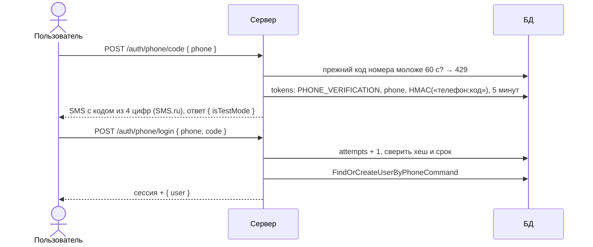

# Вход по телефону

Статус: **реализовано** (сервер и страница `/auth/login`, вкладка «Телефон»). Решения — [ADR 0011](../adr/0011-phone-signup-funnel.md),
[ADR 0012](../adr/0012-user-name-optional.md), [ADR 0013](../adr/0013-sms-ru-provider.md).

## Шаги

| Шаг                    | Команда                                                             | Модуль                      |
|------------------------|---------------------------------------------------------------------|-----------------------------|
| Отправка кода          | `SendPhoneCodeCommand` → `SendPhoneCodeHandler`                     | `auth`                      |
| Проверка кода и сессия | `LoginByPhoneCommand` → `LoginByPhoneHandler`                       | `auth`                      |
| Аккаунт по номеру      | `FindOrCreateUserByPhoneCommand` → `FindOrCreateUserByPhoneHandler` | `user` (через `CommandBus`) |

## Чей номер

- Номер подтверждён в аккаунте — вход в этот аккаунт.
- Номер указан в другом аккаунте, но не подтверждён — `releasePhone()` очищает его там, затем создаётся новый аккаунт.
- Номера нет — `User.createByPhone()`: `method = PHONE`, телефон подтверждён, email, пароля и имени нет.

## Ошибки

| Ситуация                                             | Ответ                                                         |
|------------------------------------------------------|---------------------------------------------------------------|
| Номер не `+7` и 10 цифр, код не 4 цифры              | 400, тексты из `SendPhoneCodeDto` / `PhoneLoginDto`           |
| Код запрошен повторно раньше чем через 60 с          | 429, «Повторно запросить его можно через N с.»                |
| SMS.ru: неверный номер, нет маршрута (202, 207, 214) | 400, «На этот номер не удаётся отправить SMS…»; код удаляется |
| SMS.ru: лимит на номер (230–233)                     | 429, «Слишком много SMS на этот номер…»; код удаляется        |
| SMS.ru недоступен или другая ошибка                  | 503, «Не удалось отправить SMS…»; код удаляется               |
| Кода для номера нет                                  | 404, «Запросите новый код»                                    |
| Неверный или истёкший код                            | 400, «Осталось попыток: N»; после 5 попыток код удаляется     |
| Два одновременных входа с новым номером              | 409 на втором (`users_phone_unique`)                          |

## Ограничения текущей реализации

- **Отправитель выбирает `createSmsSender`.** Задан `SMS_RU_API_ID` — `SmsRuSmsSender`; в разработке по умолчанию с
  `test=1` (SMS не уходит, баланс не тратится, текст в логе `WARN … тестовый режим SMS.ru`). Без `SMS_RU_API_ID` —
  `LogSmsSender`, только при `NODE_ENV=development`. В обоих случаях ответ `isTestMode: true`, и страница
  подсказывает, что код — в логе сервера.
- **Защита от перебора номеров:** reCAPTCHA на `/auth/phone/code`, в разработке отключена, и пауза 60 с на номер.
  Лимита по IP нет.
- Код отправляется на любой номер: ответ не раскрывает, есть ли аккаунт.
